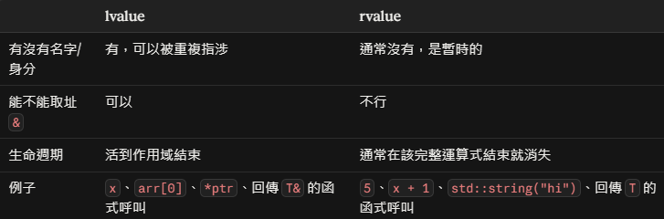

> C++ 這兩塊只看書很難真正懂，要親手寫、親手踩坑才會內化。

這篇整理兩個寫 C++ 專案前一定會碰到的主題：

1. **Memory management**：C++ 沒有 garbage collector，物件什麼時候被釋放要自己負責。
2. **Library 要先編譯再連結**：C++ 沒有像 `pip install` 那樣統一的套件系統，library 常常要自己 build 成 binary 再接上。

---

## Memory Management

### 為什麼 C++ 要自己管記憶體？

Python、Java、JS 這些語言有 garbage collector（GC）幫你回收記憶體；C++ 沒有。但這不代表「所有東西」都要手動釋放 —— 要看物件的**儲存期（storage duration）**：

| 儲存期 | 例子 | 通常放在哪 | 誰負責釋放 |
| --- | --- | --- | --- |
| 自動（automatic） | 函式裡的區域變數 `int x;`、`std::string s;` | Stack（堆疊） | **編譯器**：離開 scope 時自動呼叫解構子 |
| 靜態（static） | 全域變數、`static` 變數 | 靜態資料區 | **程式結束時**自動釋放 |
| 動態（dynamic） | `new` 出來的物件 | Heap（堆積） | **開發者**：必須自己 `delete`，否則 memory leak |

所以「由開發者自己決定物件什麼時候被釋放」指的是**動態配置**的物件。現代 C++ 的思路是：**把動態資源包進自動物件裡**，讓編譯器幫你在對的時間釋放 —— 這就是下面要講的 RAII。

現代 C++ 其實不太鼓勵手動 `new` / `delete`，而是靠這幾個觀念：

- **RAII**：物件離開 scope 時，自動在 destructor 釋放資源。
- **Ownership**：用 `std::unique_ptr`（唯一擁有者）、`std::shared_ptr`（共享擁有）來表達**誰擁有這塊記憶體**。
- **Move semantics**：資源可以「搬」給別人，而不是每次都複製。
- **Rule of 0/3/5**：物件被複製或搬移時會發生什麼事，以及哪些函式要自己寫。

以下分別說明。

---

### RAII（Resource Acquisition Is Initialization）

> RAII binds **the life cycle** of a resource that must be acquired before use (allocated heap memory, thread of execution, open socket, open file, locked mutex, disk space, database connection—anything that exists in limited supply) to the **lifetime** of an object.
>
> — cppreference

#### 核心概念

1. **將「必須先取得才能使用的資源」的生命週期，綁定到物件的生命週期上。**
    - 取得資源（Acquisition）發生在物件的建構子（Constructor）中
    - 釋放資源（Release）發生在物件的解構子（Destructor）中

    → 只要物件「活著」，資源就「在」；只要物件「死亡」，資源就一定「被釋放」。

2. **存取保證與釋放順序**：RAII 保證任何能存取該物件的函式都能使用該資源；當物件生命週期結束時，所有資源會以**取得順序的相反順序**被釋放（LIFO，後進先出）。

3. **建構失敗時的清理**：若資源取得失敗（建構子因拋出例外而退出），所有**已完整建構**的成員及基底類別子物件，會以**初始化的相反順序**被解構並釋放資源。
    - ⚠️ 注意：此時該物件本身的解構子**不會**被呼叫（因為它從未建構完成）。所以一個類別若要管理多個資源，應讓每個資源各自由一個 RAII 成員管理，而不是在建構子裡手動取得多個 raw 資源。

4. 第 2、3 點合起來，**消除了資源洩漏並保證例外安全（exception safety）**。

5. 由於 RAII 物件常隨作用域結束而銷毀，因此又被稱為「作用域綁定資源管理」（**Scope-Bound Resource Management**，簡稱 SBRM）。
    - **資源**：例如 memory、file handles、network sockets、database handles……這些資源是有限的，所以需要控管它們的使用量。
    - **Scope-Bound**：物件的生命週期綁定在變數的**作用域**上，變數離開作用域時，解構子就會釋放資源 → exception safety。

#### 範例：沒有 RAII 會發生什麼事？

```cpp
RawResourceHandle* handle = createNewResource(); // 1. 在 Heap 配置記憶體
handle->performInvalidOperation();               // 2. 若這裡拋出 Exception！
delete handle;                                   // 3. 這行永遠不會被執行 -> Memory Leak
```

當第 2 行拋出例外（Exception）或函式提早 `return` 時，control flow 會直接離開函式，導致最後的 `delete handle;` 被跳過，該塊記憶體永遠無法釋放。

#### 範例：使用 RAII

```cpp {linenos=true}
class ManagedResourceHandle {
public:
    explicit ManagedResourceHandle(RawResourceHandle* raw) : rawHandle(raw) {}
    ~ManagedResourceHandle() { delete rawHandle; }
    ManagedResourceHandle(const ManagedResourceHandle&) = delete;            // 禁止複製，避免 double delete
    ManagedResourceHandle& operator=(const ManagedResourceHandle&) = delete;
    RawResourceHandle* operator->() const { return rawHandle; }             // 讓 handle-> 可用
private:
    RawResourceHandle* rawHandle;
};

ManagedResourceHandle handle(createNewResource());
handle->performInvalidOperation();
```

> In this latter case, when the exception is thrown and the stack is unwound, the local variables are destroyed which ensures that our resource is cleaned up and doesn't leak.
>
> — Stack Overflow

這段程式碼結合了 **RAII + Stack Unwinding**：

1. **把 Heap 資源的生命週期綁到 Stack 物件上**（第 12 行）：`handle` 是配置在 Stack 上的區域物件，建構時接管了 `createNewResource()` 回傳的 Heap 指標。
2. **例外發生時自動清理（Stack Unwinding）**：當第 13 行拋出例外時，執行期環境會展開堆疊，並依序呼叫該層所有已建構區域物件的解構子，因此 `~ManagedResourceHandle()` 一定會被觸發。
3. **解構子負責釋放 Heap 資源**（第 4 行）：只要解構子被呼叫，`delete rawHandle;` 就必然執行。無論函式是正常結束、提早 `return`，還是因例外中斷，Stack 上的區域物件都會執行解構子，確保動態配置的資源被回收。

> 💡 **小細節**：Stack Unwinding 的保證前提是例外**有被某處 `catch` 到**。若例外一路沒被捕捉，會呼叫 `std::terminate()`，此時是否展開堆疊由實作決定（implementation-defined）。

> 💡 **為什麼要 `= delete` 複製？** 若允許預設複製，兩個物件會持有同一個指標，各自解構時就會 double delete。這也是 Rule of Three / Five 的精神（見下文）；實務上直接用 `std::unique_ptr<RawResourceHandle>` 即可，不用自己寫這個類別。

#### 易混淆：RAII ≠ Stack Allocation + Stack Unwinding

把 RAII 理解為「Stack Allocation + Stack Unwinding」，只看到了它在函式區域中使用時的**一種表現形式**，並沒有觸及 RAII 的核心。

**為什麼常常牽涉到 Stack？** 因為 C++ 對**自動儲存期物件**（區域物件，放在 Stack 上）提供了很強的生命週期保證：

- **正常離開作用域**：執行到 `}` 或 `return` 時，物件生命週期結束，編譯器自動呼叫解構子。
- **例外離開作用域**：拋出例外時，執行期展開堆疊，途經的所有已建構區域物件，其解構子都會被呼叫。

因此把資源包成物件放在 Stack 上，資源就不會洩漏 —— 這也是 SBRM 這個名稱的由來。

**但是！RAII 管理的物件不一定要直接放在 Stack 上**，例如：

1. **成員物件（組合）**

    ```cpp
    class ConnectionPool {
        std::vector<Socket> sockets; // std::vector 和 Socket 都是 RAII 物件
    };
    ```

    即使 `ConnectionPool` 是用 `new` 配置在 Heap 上，只要它被 `delete`，其成員的解構子就會依序觸發，釋放所有 socket 與 vector 的動態記憶體 —— 完全不依賴 Stack。

2. **智慧指標（例如 `std::shared_ptr`）**：所有權可以跨作用域、跨執行緒轉移。資源的釋放綁定在「**最後一個持有它的 `shared_ptr` 被銷毀或 reset 時**」，與單一函式的 Stack 和 Stack Unwinding 沒有必然關係。關於 smart pointer 的介紹可以[點這邊](https://medium.com/@lulululu_ej/smart-pointer-in-c-58d55dbace1f)。

#### RAII 總結

> **把「資源的生命週期（Lifecycle）」綁定到「物件的生命週期（Object Lifetime）」上。**

- 將每個資源封裝進一個類別中：
    - **Constructor** 負責取得資源，並建立所有 class invariant；若無法做到則 throw exception。
    - **Destructor** 負責釋放資源，且絕不 throw exception（C++11 起解構子預設即為 `noexcept`）。
- 永遠透過 RAII 類別的實例來使用資源，該實例：
    - 本身具有自動儲存期或暫時生命週期，**或**
    - 其生命週期受限於某個自動或暫時物件的生命週期
- RAII 借用了 C++ 對物件解構的鐵律保證，讓程式設計師不再需要手動寫 `delete`、`fclose()` 或 `unlock()`。標準庫裡的對應工具：

| 資源 | 手動寫法 | RAII 寫法 |
| --- | --- | --- |
| Heap 記憶體 | `new` / `delete` | `std::unique_ptr`、`std::shared_ptr`、`std::vector`、`std::string` |
| 檔案 | `fopen` / `fclose` | `std::fstream` |
| Mutex | `lock()` / `unlock()` | `std::lock_guard`、`std::unique_lock`、`std::scoped_lock` |
| Thread | `join()` | `std::jthread`（C++20，解構時自動 join） |

#### 附註

RAII 不適用於那些「**使用前不需要先取得**」的資源，例如：CPU time、core availability、cache capacity、entropy pool capacity、network bandwidth、electric power consumption、stack memory。這些資源沒有明確的「取得」與「歸還」動作，自然也無法綁在建構子/解構子上。

#### Reference

- https://cppreference.tw/w/cpp/language/raii
- https://en.cppreference.com/w/cpp/language/raii
- https://stackoverflow.com/questions/2321511/what-is-meant-by-resource-acquisition-is-initialization-raii

---

### Ownership

> Ownership is an imaginary token on a stack allocated object meaning the responsibility to clean up the resource.
>
> — Adam Rudolf

**白話：ownership 就是「誰負責在最後把這個資源釋放掉」。**

這句話的重點有三個：

1. **imaginary（想像出來的）**：C++ 編譯器**不會**檢查 ownership（不像 Rust 的 borrow checker 會在編譯期強制）。它是一個**約定**，寫錯了編譯器不會擋你，只會在執行時變成 leak 或 double free。
2. **token（令牌）**：每個資源同一時間應該有明確的擁有者。擁有者可以把令牌**交出去**（move）或**共享**（shared_ptr），但不能「兩個人都以為自己要負責」（→ double free），也不能「沒有人負責」（→ memory leak）。
3. **on a stack allocated object**：令牌最終一定握在某個 Stack 上的物件（或它的成員）手上。Stack 物件結束時，解構子一路連鎖釋放 —— 這就是 RAII。

所以讀這段要懂的是：**現代 C++ 用「型別」把 ownership 寫出來**，讓看程式碼的人（和編譯器）一眼就知道誰負責釋放。

| 寫法 | 意思 | 誰釋放資源 |
| --- | --- | --- |
| `std::unique_ptr<T>` | **唯一擁有者**。不能複製，只能 `std::move`（所有權轉移） | `unique_ptr` 被銷毀時 |
| `std::shared_ptr<T>` | **共享擁有**。內部有 reference count | **最後一個** `shared_ptr` 被銷毀時 |
| `std::weak_ptr<T>` | **不擁有**，只觀察 `shared_ptr` 管理的物件；使用前要 `lock()` | 不負責 |
| `T*`、`T&`（raw pointer / reference） | **不擁有**，只是「借用」 | 不負責，也**不該** `delete` 它 |

#### 從函式簽名看出所有權

```cpp
void use(const Widget& w);                // 只是借用，不關心所有權（最常見）
void use(Widget* w);                      // 借用，但可能是 nullptr
void take(std::unique_ptr<Widget> w);     // 拿走所有權：呼叫端必須 std::move
void share(std::shared_ptr<Widget> w);    // 成為共同擁有者：refcount +1

auto w = std::make_unique<Widget>();      // 用 make_unique，不寫 new
use(*w);                                  // 借給別人用，所有權還在我這
take(std::move(w));                       // 所有權交出去，之後 w == nullptr
```

#### 選擇原則

1. **預設用 `std::unique_ptr`**；真的需要多個擁有者時才用 `std::shared_ptr`（它有 refcount 的成本）。
2. 用 `std::make_unique` / `std::make_shared` 建立，**程式碼裡不要出現裸的 `new` / `delete`**。
3. Raw pointer / reference 只用來「借用」，永遠不代表擁有。
4. ⚠️ `shared_ptr` 互相指向會形成**循環引用**，refcount 永遠不會歸零 → memory leak。解法是其中一邊改用 `weak_ptr`：

    ```cpp
    struct Node {
        std::shared_ptr<Node> next;  // 擁有下一個
        std::weak_ptr<Node>   prev;  // 只觀察上一個，打破循環
    };
    ```

#### Reference

- https://medium.com/@rudolf.adam.a/what-exactly-is-ownership-in-c-5de15b6bd50b
- [C++ Core Guidelines — R: Resource management](https://isocpp.github.io/CppCoreGuidelines/CppCoreGuidelines#S-resource)

---

### Move Semantics

要理解 move semantics 之前，要先對 left value（lvalue）跟 right value（rvalue）有基本認知。

#### lvalue、rvalue 名字的由來

C 語言早期的直覺說法：

- **lvalue**：可以出現在指派運算子**左邊**的東西
- **rvalue**：只能出現在**右邊**的東西

```cpp
int x = 5;   // x 是 lvalue，5 是 rvalue
5 = x;       // ❌ 編譯錯誤，5 不能放左邊
```

不過這個「左右」的說法在現代 C++ 已經不太準了（例如 `const int y = 1;` 的 `y` 是 lvalue，但不能放左邊），比較好的理解方式是看下面這個判斷標準：



一個實用的判斷法：**能不能對它取址（`&expr`）？能就是 lvalue。**

#### 右值引用（`T&&`）要解決什麼問題？

rvalue 是「馬上就要死掉的暫時物件」，既然沒人會再用它，就可以直接**搶走它內部的資源**，不必複製。這就是 **move semantics** —— C++11 引入的效能優化機制：

> 允許將資源（如動態配置的記憶體）從一個物件「直接轉移」給另一個物件，而不需要進行昂貴的複製（Copy）操作。

#### 範例：Copy vs Move

```cpp {linenos=true}
std::string a = "hello";
std::string b = a;              // ① a 是 lvalue → 複製（a 之後還要用）
std::string c;
c = a + " world";               // ② a + " world" 是暫時物件（rvalue）→ 移動賦值
std::string d = std::move(a);   // ③ 主動把 a 轉成 rvalue → 移動建構（之後別再依賴 a 的內容）
```

- **①**：`a` 有名字、之後還可能被使用，所以只能複製。`b` 也是 lvalue：有名字、有固定記憶體位址、可以對它取址（`&b`）。
- **②（第 4 行）**：
    - 執行到 `a + " world"` 時，程式會建立一個**沒有名字的暫時字串物件**（Temporary Object），內容是 `"hello world"`。它只存在於這一行敘述中，整行結束後就會被銷毀。
    - **如果用複製（Copy，浪費效能）**：暫時物件已經在 Heap 上配置了一塊記憶體；`c` 又要在 Heap 上再要一塊新的，把 `"hello world"` 逐字抄過去。這行結束後暫時物件被銷毀，第一塊記憶體隨即被釋放 —— 結果配置了兩次記憶體、複製了一次資料，白白浪費。
    - **用移動（Move，C++11 起）**：編譯器發現等號右邊是 rvalue，於是呼叫 `c` 的**移動賦值運算子（Move Assignment Operator）**。`c` 直接把內部指標指向暫時物件**已經配置好的 Buffer**，並把暫時物件內部的指標清空。完全不需要重新配置記憶體或逐字拷貝，直接把暫時物件的心血「搶過來」自己用 —— 這就是**轉移擁有權**。
- **③**：`std::move(a)` 把 `a` 轉成 rvalue，觸發 `d` 的**移動建構子（Move Constructor）**。之後 `a` 處於「有效但未指定（valid but unspecified）」的狀態：可以重新賦值或銷毀，但不要依賴它的內容。

> 💡 **如果寫成 `std::string c = a + " world";` 呢？**
> C++17 起有**保證的複製省略（guaranteed copy elision）**：用 prvalue 初始化同型別物件時，暫時物件根本不會被建立，`operator+` 的結果**直接建構在 `c` 身上** —— 連 move 都不用。這比 move 還省，所以上面範例才故意拆成「先宣告、再賦值」來示範 move。

> 💡 **Small String Optimization（SSO）**
> 主流標準庫實作中，短字串（libstdc++ / MSVC 約 15 字元以內，libc++ 約 22 字元）會直接存在 `std::string` 物件內部，**不會配置 Heap**。`"hello world"` 只有 11 個字元，所以實際上 move 時是把字元複製過去。上面「搶指標」的說明要想像成**長字串**才完全成立；觀念本身不受影響。

#### 引用的綁定規則

| 引用型別 | 可以綁定 |
| --- | --- |
| `T&`（左值引用） | 只有 lvalue |
| `const T&` | lvalue 和 rvalue 都可以 |
| `T&&`（右值引用） | 只有 rvalue |

> ⚠️ 例外：在 template 裡，`template <typename T> void f(T&& x)` 的 `T&&` 是 **forwarding reference（萬能引用）**，lvalue 和 rvalue 都能綁，通常搭配 `std::forward` 使用。

#### `std::move` 不會移動任何東西

`std::move` **本身不會移動任何東西**。它只是一個轉型（等同 `static_cast<T&&>(x)`），把 lvalue 轉成 rvalue（精確說是 xvalue），讓編譯器去選擇 move constructor / move assignment。真正「搬」資源的是那兩個函式。

很容易搞錯的一點：**有名字的右值引用變數，本身是 lvalue。**

```cpp {linenos=true}
void foo(std::string&& s) {
    std::string t = s;              // 這裡是「複製」！因為 s 有名字，是 lvalue
    std::string u = std::move(s);   // 要再 move 一次才會移動
}
```

第 3 行我曾經混淆的觀念 —— **型別（Type）vs 實值類別（Value Category）**：

- `s` 本身從頭到尾都沒有「被轉化」，被轉化的是「**表達式 `std::move(s)` 的結果**」。
    - **Type**：`s` 的宣告型別確實是 `std::string&&`（右值引用型別）。
    - **Value Category**：有名字、可取址，所以 `s` 這個表達式永遠都是 lvalue。
- `std::move(s)` 做了什麼？
    - 強制型別轉換（`static_cast<std::string&&>(s)`），它不會修改 `s` 的本質，而是產生一個暫時的轉型結果（xvalue，屬於 rvalue）。
    - `u` 的建構子接收到這個 rvalue，觸發 Move Constructor，把 `s` 內部管理的 Heap 記憶體指標搶走，並讓 `s` 變成 moved-from 狀態（實作上通常是空字串）。
- 結論：`s` 本身沒有被轉化為 rvalue；只是它的內容被 `u` 搬空了，`s` 依舊是名為 `s` 的 lvalue。

#### 補充：C++11 的完整分類

C++11 為了支援 move，把 value category 細分成五種：

```text
              expression
              /        \
         glvalue      rvalue
         /     \      /     \
     lvalue     xvalue     prvalue
```

- **prvalue**（pure rvalue）：純暫時值，例如 `5`、`x + 1`、`a + " world"`
- **xvalue**（eXpiring value）：有身分但即將被移走，例如 `std::move(x)` 的結果
- **glvalue** = lvalue + xvalue（有身分的）
- **rvalue** = prvalue + xvalue（可以被移動的）

#### 開個小岔：`std::string` 的複製是 Deep Copy

如果你自己定義一個簡單的 class，且沒有實作 Copy Constructor，編譯器會自動產生一個「**逐成員複製**」的版本；如果成員是 raw pointer，就只會複製指標位址（shallow copy）—— 這就是下面「為什麼需要 Rule of Three」的原因。

`std::string` 不一樣：它是標準庫寫好的類別，開發者已經**手動實作**了 Copy Constructor。為了保證每個字串獨立、互不干擾、避免 Double Free，它的複製會配置一塊新的 Heap 記憶體，再把內容逐字複製過去（標準的 Deep Copy）。

也因此「暫時物件剛建好的記憶體馬上就要被丟棄，卻還要再做一次 Deep Copy」才會是浪費 —— 這正是 move semantics 要解決的問題。

#### 標準庫型別的複製 / 移動行為整理

| 類別 | 型別 | 複製 | 移動 |
| --- | --- | --- | --- |
| **擁有資源的容器** | `std::string`、`vector`、`deque`、`list`、`forward_list`、`map`、`set`、`unordered_map`、`unordered_set` | ✅ Deep copy：重新配置記憶體，逐一複製每個元素 | ✅ 接手內部指標（通常 O(1)） |
| **共享擁有** | `std::shared_ptr` | ✅ 既不是淺拷貝也不是深拷貝：指向同一個物件，control block 的 refcount +1（原子操作） | ✅ 轉移，refcount 不變 |
| **獨佔資源（move-only）** | `std::unique_ptr`、`std::thread`、`std::fstream`、`std::unique_lock` | ❌ `= delete`，編譯直接報錯 | ✅ 只能用 `std::move` 轉移所有權 |
| **不可複製、也不可移動** | `std::mutex`、`std::lock_guard` | ❌ | ❌ |
| **不擁有的 View / 觀察者** | `std::string_view`（C++17）、`std::span`（C++20）、`std::weak_ptr` | ✅ 淺複製：只複製指標與長度（`weak_ptr` 則是 weak count +1） | ✅ |

補充兩個容易踩的坑：

- **容器的 deep copy 只「深」到元素為止**：`std::vector<int*>` 複製時，複製的是指標本身，指標指向的 `int` 不會被複製。
- **View 不擁有資料**：`std::string_view sv = std::string("hi");` —— 暫時字串在這行結束就被銷毀，`sv` 立刻變成 dangling。

---

### Rule of 0 / 3 / 5

C++ 中有 6 個由編譯器視情況自動產生的**特殊成員函式（special member functions）**：

1. Default Constructor `T()`
2. Destructor `~T()`
3. Copy Constructor `T(const T&)`
4. Copy Assignment Operator `T& operator=(const T&)`
5. Move Constructor `T(T&&)`
6. Move Assignment Operator `T& operator=(T&&)`

當你的類別需要自行管理資源（例如透過裸指標分配的動態記憶體、作業系統 Handle 等）時，編譯器預設產生的「逐成員複製」對指標而言只是 shallow copy，往往會造成 Double Free 或 Dangling Pointer。為了解決這些問題，便衍生出以下法則。

#### Rule of Three

> **原則**：如果一個類別需要自訂（user-defined）Destructor、Copy Constructor 或 Copy Assignment Operator 其中任何一個，那麼它通常三個都需要自訂。

**原因**：如果你需要 Destructor，通常代表該物件擁有需要手動釋放的資源（例如呼叫了 `delete`）。若此時不自訂複製行為，**編譯器產生的預設複製只會把指標位址複製一份**。當兩個物件都指向同一塊記憶體，解構時就會觸發 **Double Free** 導致程式崩潰。

```cpp
class RuleOfThree {
    int* data;
public:
    RuleOfThree(int val) : data(new int(val)) {}

    // 1. 解構子：釋放資源
    ~RuleOfThree() { delete data; }

    // 2. 複製建構子：深複製（Deep Copy）
    RuleOfThree(const RuleOfThree& other) : data(new int(*other.data)) {}

    // 3. 複製賦值運算子：先配置新資源，成功後才釋放舊資源
    RuleOfThree& operator=(const RuleOfThree& other) {
        if (this != &other) {
            int* fresh = new int(*other.data);  // 可能 throw，所以先做
            delete data;                         // 走到這裡代表配置成功了
            data = fresh;
        }
        return *this;
    }
};
```

> ⚠️ **為什麼不寫成 `delete data; data = new int(*other.data);`？**
> 如果 `new` 拋出例外（例如記憶體不足），`data` 已經被 `delete` 了卻還指著原位址，物件之後解構時就會 double free。「**先配置、再釋放**」或 **copy-and-swap**（建一個暫時副本再 `swap`）都能確保例外安全。

#### Rule of Five

> **原則**：C++11 引入了右值引用（Rvalue Reference）與移動語意（Move Semantics）。如果一個類別自訂了 Rule of Three 中的任何一個，就應該一併考慮自訂 Move Constructor 與 Move Assignment Operator。

**原因**：只要使用者宣告了解構子或複製函式，編譯器便**不會自動產生**移動操作。如果不自訂移動操作，遇到暫時物件（rvalue）時，C++ 會退化（fallback）去呼叫昂貴的 deep copy，喪失移動語意帶來的效能優勢。

編譯器自動產生的規則（簡化版）：

| 你宣告了… | 編譯器還會自動產生 copy 嗎？ | 會自動產生 move 嗎？ |
| --- | --- | --- |
| 什麼都沒宣告 | ✅ | ✅ |
| 解構子 | ✅（但已被標為 deprecated） | ❌ → rvalue 會 fallback 成 copy |
| Copy constructor 或 copy assignment | ✅ 另一個（deprecated） | ❌ |
| Move constructor 或 move assignment | ❌ 兩個 copy 都變成 `= delete` | ❌ 另一個 move 也不會產生 |

所以 3 + 2 → 5，這五個函式為：

1. 解構子 `~T()`
2. 複製建構子 `T(const T&)`
3. 複製賦值運算子 `T& operator=(const T&)`
4. 移動建構子 `T(T&&)`
5. 移動賦值運算子 `T& operator=(T&&)`

```cpp
class RuleOfFive {
    int* data;
public:
    RuleOfFive(int val) : data(new int(val)) {}

    // 1. 解構子 ~T()
    ~RuleOfFive() { delete data; }

    // 2. 複製建構子 T(const T&)
    RuleOfFive(const RuleOfFive& other) : data(new int(*other.data)) {}

    // 3. 複製賦值運算子 T& operator=(const T&)
    RuleOfFive& operator=(const RuleOfFive& other) {
        if (this != &other) {
            int* fresh = new int(*other.data);
            delete data;
            data = fresh;
        }
        return *this;
    }

    // 4. 移動建構子：轉移資源擁有權，並將來源置空（nullify）
    RuleOfFive(RuleOfFive&& other) noexcept : data(other.data) {
        other.data = nullptr;
    }

    // 5. 移動賦值運算子：釋放自己的資源，接管來源資源
    RuleOfFive& operator=(RuleOfFive&& other) noexcept {
        if (this != &other) {
            delete data;
            data = other.data;
            other.data = nullptr;
        }
        return *this;
    }
};
```

> 💡 **Move 操作為什麼要加 `noexcept`？**
> `std::vector` 擴容時要把舊元素搬到新空間。如果 move constructor 沒有標 `noexcept`，vector 為了維持「擴容失敗時原資料不受影響」的保證，會改用 **copy**（`std::move_if_noexcept`），move 的效能優勢就沒了。

> ⚠️ **Moved-from 物件**：被 move 走之後，`other.data` 是 `nullptr`。這時如果再對 `other` 做複製（`*other.data`），就會解參考空指標。被 move 過的物件只應該被**重新賦值或銷毀**。

#### Rule of Zero（現代 C++ 最佳實踐）

> **原則**：如果一個類別不直接管理裸資源，就**不要宣告**上述五個特殊成員函式中的任何一個（全部留給編譯器預設產生）。

**概念**：遵循**單一職責原則**（Single Responsibility Principle）：

- 資源的管理應該交給專門的 RAII 類別（例如 `std::unique_ptr`、`std::shared_ptr`、`std::vector`、`std::string`）。
- 你的業務邏輯類別只需要包含這些標準庫型別，編譯器就會自動產生正確且高效的建構、複製、移動與釋放行為。

```cpp
// 遵循 Rule of Zero：不需要手動撰寫任何 Destructor 或 Copy/Move
class RuleOfZero {
    std::string name;
    std::vector<int> numbers;
    std::unique_ptr<int> extra_data;
    // 所有成員都自帶完整的 RAII 語意，編譯器自動產生的函式就是最正確且安全的
};
```

> 💡 注意：因為成員裡有 `std::unique_ptr`（move-only），編譯器產生的 copy 會變成 `= delete`，所以 `RuleOfZero` **只能 move、不能 copy**。這是正確的行為 —— 編譯器幫你推導出「獨佔資源的類別不該被複製」。如果真的需要複製，就把成員改成 `std::shared_ptr`（共享）或自己寫 deep copy。

#### 總結

| 法則 | 適用時機 | 核心精神 |
| --- | --- | --- |
| Rule of Three | C++98 / 舊專案環境 | 只要有自訂釋放行為，解構、複製建構、複製賦值 3 個都要寫。 |
| Rule of Five | 自訂底層資源包裝器（如自製智慧指標、Buffer） | 只要寫了其中一個，5 個全部明確定義（兼顧安全性與移動效能）。 |
| Rule of Zero | 一般業務邏輯類別（**現代 C++ 強烈推薦**） | 一個都不要寫，善用 `std::unique_ptr` 等 RAII 型別管理資源。 |

#### Reference

- https://en.cppreference.com/w/cpp/language/rule_of_three

---

### 開發時常見的坑

| 問題 | 是什麼 | 最小範例 | 怎麼避免 |
| --- | --- | --- | --- |
| **Memory leak** | 配置了記憶體卻沒有釋放，程式跑越久吃越多 | `int* p = new int(1);`（沒有 `delete`） | 用 `std::unique_ptr` / 容器；`shared_ptr` 循環引用改用 `weak_ptr` |
| **Dangling pointer** | 指標指向的記憶體已經被釋放（或物件已經結束生命週期），指標本身卻還在 | `int* p = new int(1); delete p;` → `p` 現在是 dangling | 釋放後不再使用；用 smart pointer 取代 raw pointer 擁有權 |
| **Use-after-free** | **使用**了 dangling pointer（讀或寫已釋放的記憶體），是 dangling pointer 最常見的後果 | `delete p; *p = 2;` | 同上；是常見的資安漏洞來源 |
| **Double free** | 同一塊記憶體被釋放兩次 | `delete p; delete p;` | 用 `unique_ptr`；自訂類別遵守 Rule of 3/5 |
| **Dangling reference** | 引用的物件已經死了 | 回傳區域變數的參考：`const std::string& f() { std::string s; return s; }` | 回傳值（by value）而不是參考；小心 `string_view` / `span` |
| **Iterator invalidation** | 容器改變後，舊的 iterator / 指標 / 參考失效 | `auto it = v.begin(); v.push_back(x); *it;`（vector 擴容後 `it` 失效） | 修改容器後重新取得 iterator |

這些 bug 的共同特徵是**未定義行為（Undefined Behavior）**：程式不一定會當掉，可能「看起來正常」，換一台機器或換個編譯選項才爆炸。所以要靠工具抓：

- **AddressSanitizer（ASan）**：編譯時加 `-fsanitize=address -g`（MSVC：`/fsanitize=address`），執行時抓 use-after-free、double free、越界存取。
- **LeakSanitizer**：Linux 上隨 ASan 一起啟用，抓 memory leak（macOS 的 Apple clang 不支援，可改用 `leaks --atExit -- ./a.out`）。
- **Valgrind**（Linux）：不需要重新編譯，但執行速度慢很多。
- **編譯器警告**：`-Wall -Wextra` 就能抓到「回傳區域變數的參考」之類的問題。

---

## Library 要先編譯再連結

### C++ 程式是怎麼變成執行檔的？

```text
 main.cpp ──┐                                       ┌── libfoo.a / foo.lib     (static library)
            │ ① 前處理    ② 編譯     ③ 組譯          │
 util.cpp ──┼──────────────────────────► .o / .obj ──┼──► ④ 連結（Linker）──► 執行檔
            │ (#include                (每個 .cpp    │
 *.h ───────┘  把 header 貼進來)        各自獨立編譯) └── libbar.so / bar.dll    (shared library)
```

1. **前處理（Preprocess）**：`#include` 其實就是把 header 檔的內容**原封不動貼進來**，`#define` 做文字替換。
2. **編譯（Compile）**：每個 `.cpp`（稱為一個 **translation unit**）**各自獨立**編譯成機器碼，產生 object file（`.o` / `.obj`）。
3. **連結（Link）**：Linker 把所有 object file 和 library 接在一起，把「A 檔呼叫了 B 檔定義的函式」這種跨檔案的參照**對上**。

關鍵觀念是**宣告（declaration）vs 定義（definition）**：

- **Header（`.h` / `.hpp`）通常只放宣告**：告訴編譯器「有一個函式叫 `add(int, int)`，回傳 `int`」，讓編譯能通過。
- **Source（`.cpp`）放定義**：函式真正的實作，會被編譯成機器碼。
- 編譯 `main.cpp` 時，編譯器只要看到宣告就夠了；**實作在哪裡，是 linker 的工作**。如果 linker 找不到，就是那個經典的 `undefined reference` 錯誤。

### Library 的種類

| 種類 | 說明 | macOS | Linux | Windows |
| --- | --- | --- | --- | --- |
| **Header-only** | 全部寫在 header 裡，`#include` 就能用，不用另外編譯或連結 | — | — | — |
| **Static library** | 連結時把用到的程式碼**整份複製進執行檔** | `.a` | `.a` | `.lib` |
| **Shared / Dynamic library** | 執行檔只記錄「我需要這個 library」，**執行時才載入** | `.dylib` | `.so` | `.dll`（+ 一個 import `.lib`） |

| | Static | Shared |
| --- | --- | --- |
| 執行檔大小 | 較大 | 較小 |
| 部署 | 執行檔單獨就能跑 | 要把 library 一起帶著，且要放在系統找得到的地方 |
| 更新 library | 要重新連結執行檔 | 換掉 library 檔即可（ABI 相容的前提下） |
| 多個程式共用 | 各自一份 | 記憶體中可共用一份 |

> 💡 為什麼很多 C++ library 是 header-only？因為 **template 的實作必須放在 header 裡**（編譯器要看到完整實作才能針對每個型別產生程式碼），例如 nlohmann/json、大部分的 Boost、整個 STL。

### 為什麼 C++ library 常常要「自己編譯」？

其他語言（Python、Java、JS）有統一的套件管理和執行環境；C++ 的 binary 則**跟編譯環境綁很緊**，這叫 **ABI（Application Binary Interface）相容性**。一個編好的 library 能不能用，取決於：

- **作業系統與 CPU 架構**：Windows x64 的 `.lib` 不能給 macOS 用；Intel Mac（x86_64）和 Apple Silicon（arm64）也不同。
- **編譯器與版本**：MSVC 和 GCC 編出來的 C++ library 不能混用；name mangling 和標準庫實作都不一樣。
- **標準庫實作**：Linux 常用 GCC 的 libstdc++，macOS 用 LLVM 的 libc++，`std::string` 的記憶體佈局不同。
- **Build 設定**：Windows 上 Debug（`/MDd`）和 Release（`/MD`）的 runtime 不能混用，混了會出現奇怪的 crash 或 linker error。

所以最保險的做法就是**拿原始碼，用跟自己專案相同的編譯器和設定 build 一次**。這也是 vcpkg、Conan 這些套件管理工具做的事：幫你下載原始碼、用你的環境編譯好、再告訴 CMake 去哪裡找。

### 常見的 Linker Error

| 錯誤訊息 | 常見原因 |
| --- | --- |
| `undefined reference to ...`（GCC / Linux）<br>`Undefined symbols for architecture ...`（macOS）<br>`LNK2019: unresolved external symbol`（MSVC） | 1. 函式有宣告但**沒有實作**<br>2. 有實作但**忘了連結**那個 library（CMake 沒寫 `target_link_libraries`）<br>3. 宣告和實作的簽名不一致（例如參數型別不同、namespace 不同）<br>4. C 和 C++ 混用，少了 `extern "C"` |
| `multiple definition of ...`<br>`LNK2005: already defined` | 在 header 裡**定義**了非 `inline` 的函式或全域變數，被多個 `.cpp` include 後重複定義（違反 One Definition Rule） |
| 執行時：`Library not loaded`（macOS）<br>`cannot open shared object file`（Linux）<br>找不到 `xxx.dll`（Windows） | 編譯連結都成功，但**執行時**找不到 shared library。macOS 看 rpath / `DYLD_LIBRARY_PATH`，Linux 看 rpath / `LD_LIBRARY_PATH`，Windows 會找執行檔同資料夾和 `PATH` |

### 觀察 binary 的工具

| 想知道 | macOS | Linux | Windows |
| --- | --- | --- | --- |
| 執行檔依賴哪些 shared library | `otool -L app` | `ldd app` | `dumpbin /dependents app.exe` |
| Library 裡有哪些 symbol | `nm -C libfoo.a` | `nm -C libfoo.a` | `dumpbin /symbols foo.lib` |

`nm` 不加 `-C` 會看到像 `_ZN7mathlib3addEii` 這種名字，這是 **name mangling**：C++ 支援函式多載和 namespace，所以編譯器會把參數型別等資訊編進 symbol 名稱裡（這裡代表 `mathlib::add(int, int)`）。`-C` 會把它還原成人看得懂的形式。

### 用 CMake 管理

實務上不會手打編譯指令，而是用 **CMake** 描述專案，讓它產生各平台的 build 檔：

```cmake
cmake_minimum_required(VERSION 3.20)
project(demo LANGUAGES CXX)
set(CMAKE_CXX_STANDARD 20)

add_library(mathlib STATIC src/mathlib.cpp)        # 自己的 static library
target_include_directories(mathlib PUBLIC include)

find_package(fmt CONFIG REQUIRED)                  # 第三方 library（例如透過 vcpkg 安裝）

add_executable(app src/main.cpp)
target_link_libraries(app PRIVATE mathlib fmt::fmt) # 連結：沒寫這行就會 undefined reference
```

```bash
cmake -S . -B build      # configure：產生 build 檔
cmake --build build      # 編譯 + 連結
```

套件管理工具：

- **[vcpkg](https://github.com/microsoft/vcpkg)**（Microsoft）：跟 CMake 整合得很好，跨平台。
- **[Conan](https://conan.io/)**：可以管理預先編好的 binary，大型專案常用。
- **CMake `FetchContent`**：直接在 CMake 裡從 GitHub 抓原始碼一起編，適合小專案。

---

## 值得讀的 Open Source Project

由淺到深，都是寫得乾淨、適合拿來學 modern C++ 的專案：

| 專案 | 為什麼值得看 |
| --- | --- |
| [nlohmann/json](https://github.com/nlohmann/json) | Header-only 的 JSON library，API 設計很直覺，可以學 template 和 operator overloading |
| [fmtlib/fmt](https://github.com/fmtlib/fmt) | `std::format`（C++20）的前身，需要編譯，適合練習 library 連結 |
| [gabime/spdlog](https://github.com/gabime/spdlog) | 高效能 logging library，可選 header-only 或 compiled 版本 |
| [google/leveldb](https://github.com/google/leveldb) | Google 的 key-value store，程式碼量不大、品質很高，是讀 C++ 系統程式的經典入門 |
| [abseil/abseil-cpp](https://github.com/abseil/abseil-cpp) | Google 內部使用的 C++ 基礎函式庫，可以看大公司怎麼寫 C++ |
| [google/googletest](https://github.com/google/googletest) | 最常用的 C++ 測試框架，自己的 side project 可以直接拿來寫 unit test |

風格與規範參考：

- [C++ Core Guidelines](https://isocpp.github.io/CppCoreGuidelines/CppCoreGuidelines)（Bjarne Stroustrup & Herb Sutter）
- [Google C++ Style Guide](https://google.github.io/styleguide/cppguide.html)

<!-- 
## 一些別人做過的練習

1. https://blog.csdn.net/m0_68865259/article/details/162907322 -->

<!-- 待填的坑 -->
<!--
1. forwarding reference（T&& in template）與 std::forward / perfect forwarding
2. smart pointer 深入：unique_ptr 自訂 deleter、shared_ptr 的 control block 與 make_shared 的差別
3. copy-and-swap idiom
4. 實作練習：MyVector（placement new + Rule of 5）、static / shared library 連結
-->